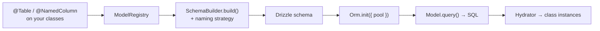

<div align="center">

# 🌊 drizzle-active-record

**Active Record models for [Drizzle ORM](https://orm.drizzle.team).**
Declare a class — get a table, a chainable query builder, relations, soft delete and real class instances back.

[](https://www.npmjs.com/package/@iappx/drizzle-active-record)
[](https://github.com/iappx/drizzle-active-record/actions/workflows/ci.yml)
[](./LICENSE)
[](https://nodejs.org)

```bash
npm install @iappx/drizzle-active-record drizzle-orm pg
```

</div>

---

## Why this exists

Drizzle is a great SQL layer, but it hands you plain rows and a schema you have to keep in sync by hand.
This package keeps Drizzle underneath — and puts your **domain classes on top**.

<table>
<tr><th width="50%">Plain Drizzle</th><th width="50%">With this package</th></tr>
<tr valign="top">
<td>

```ts
const rows = await db
    .select()
    .from(programs)
    .leftJoin(exercises, eq(...))
    .where(and(
        eq(programs.userId, userId),
        isNull(programs.deletedAt),
    ))

// plain objects, joins flattened by hand,
// `deletedAt` remembered by hand
```

</td>
<td>

```ts
const list = await TrainingProgram.query()
    .where({ userId })
    .includeModel(TrainingExercise)
    .endInclude()
    .getAll()

// TrainingProgram[] with methods,
// nested exercises, soft delete applied
```

</td>
</tr>
</table>

## ✨ Highlights

| | |
|---|---|
| 🧩 **Decorators define everything** | One class is the model, the schema and the API surface. No parallel `schema.ts` to maintain. |
| 🔗 **Relations that nest** | `belongsTo` / `hasOne` / `hasMany` / `belongsToMany` — including type-safe nested sub-queries with their own `where`, `orderBy` and `limit`. |
| 🧬 **Real instances, not rows** | Every result is hydrated back into your class — methods, getters and nested relation instances included. |
| ♻️ **Dirty tracking** | `save()` writes only the fields you actually changed; `changed()` tells you which ones. |
| 🗑️ **Soft delete on autopilot** | `paranoid: true` and deleted rows disappear from every `SELECT`, `count()` and `EXISTS` sub-query. |
| 🎯 **Expressive filters** | `Op.gte`, `Op.in`, `Op.like`, `Op.between`, `Op.or(...)` — or drop to a raw Drizzle `SQL` fragment any time. |
| ✍️ **Your naming, your rules** | Pluggable naming strategy: snake_case, PascalCase, preserve — or a five-line class of your own. |
| 🔒 **Transactions everywhere** | Any read or write takes `{ transaction }` and joins an existing Drizzle transaction. |
| 🌲 **Recursive queries** | `WITH RECURSIVE` over self-referencing tables — with relations, in one statement. Drizzle has no builder for it. |
| ⚖️ **Read replicas** | `.useReplica()` on the queries that may lag; everything else stays on the primary. |
| 🪶 **Zero runtime deps** | `drizzle-orm` and `pg` are peer dependencies — the library reuses the instance your app already has. |

## 🗺️ How it works



Decorators only *record* metadata. Nothing touches the database until `Orm.init()`, so models can be
imported in any order and the naming strategy can be installed after the model files are loaded.

---

## 🚀 Quick start

### 1. Describe a model

```ts
import {
    BelongsTo, CreatedColumn, DataType, DeletedColumn, ForeignKey,
    HasMany, NamedColumn, QueryableModel, Table, UpdatedColumn,
} from '@iappx/drizzle-active-record'

// attributes accepted by create() / update()
interface TrainingProgramCA {
    id?: number
    title: string
    userId: number
}

@Table('training_program', { paranoid: true })
export class TrainingProgram extends QueryableModel<TrainingProgram, TrainingProgramCA> {
    @NamedColumn(DataType.BIGINT, 'id', { primaryKey: true, autoIncrement: true })
    id: number

    @NamedColumn(DataType.STRING, 'title')
    title: string

    @ForeignKey(() => User)
    @NamedColumn(DataType.BIGINT, 'user_id')
    userId: number

    @CreatedColumn()
    @NamedColumn(DataType.DATE, 'created_at')
    createdAt: Date

    @UpdatedColumn()
    @NamedColumn(DataType.DATE, 'updated_at')
    updatedAt: Date

    @DeletedColumn()
    @NamedColumn(DataType.DATE, 'deleted_at')
    deletedAt: Date

    @BelongsTo(() => User)
    user: User

    @HasMany(() => TrainingExercise)
    exercises: TrainingExercise[]
}
```

### 2. Boot the ORM once

```ts
import { Pool } from 'pg'
import { Orm, SchemaBuilder, SnakeCaseNamingStrategy } from '@iappx/drizzle-active-record'
import './models'  // side-effect import: decorators must run before build

SchemaBuilder.setNamingStrategy(new SnakeCaseNamingStrategy())

Orm.init({ pool: new Pool({ host, port, user, password, database }) })
```

### 3. Use it

```ts
const programs = await TrainingProgram.query()
    .where({ userId, title: Op.like('%warm%') })
    .orderBy('createdAt', 'DESC')
    .limit(20)
    .includeModel(TrainingExercise)
        .where({ isActive: true })
        .orderBy('position')
    .endInclude()
    .getAll()

programs[0].exercises[0] instanceof TrainingExercise  // true

const program = await TrainingProgram.create({ title: 'Push day', userId })
await program.update({ title: 'Push day A' })
await program.destroy()  // soft delete — the row stays, deletedAt is set
```

> [!TIP]
> Everything after this point is reference material — jump to what you need:
> [Models](#-models) · [Column naming](#-column-naming) · [Bootstrap](#-bootstrap) · [Querying](#-querying) ·
> [Grouping](#-grouping) · [Recursive queries](#-recursive-queries) · [Filters](#-filter-operators) ·
> [Relations](#-relations--includes) · [TableRef](#-tableref--correlated-sub-queries-from-metadata) · [Writing](#-writing-data) ·
> [Transactions](#-transactions) · [Soft delete](#-soft-delete) · [Raw SQL](#-raw-sql-escape-hatches) ·
> [SQL expressions](#-sql-expressions--fn-and-pgexpr) · [TypeScript setup](#-typescript-setup)

---

## 🧩 Models

A model is a class extending `QueryableModel<Self, CreationAttributes>` and decorated with `@Table`.

| Decorator | What it does |
|---|---|
| `@Table(name, { paranoid })` | Registers the class as a table. Object form `@Table({ tableName, paranoid })` works too. |
| `@NamedColumn(type, name?, options?)` | Maps a property to a column. Omit `name` to let the [naming strategy](#-column-naming) derive it. |
| `@CreatedColumn()` / `@UpdatedColumn()` | Marks timestamp columns. Stack above `@NamedColumn`. |
| `@DeletedColumn()` | Soft-delete marker. Active only together with `paranoid: true`. |
| `@ForeignKey(() => Model)` | Marks the FK column. Stack above `@NamedColumn`. |
| `@BelongsTo(() => Model, { foreignKey? })` | Many-to-one (this table holds the FK). |
| `@HasOne(() => Model, { foreignKey? })` | One-to-one (this table holds the FK). |
| `@HasMany(() => Model, { foreignKey? })` | One-to-many (the other table holds the FK). |
| `@BelongsToMany(() => Model, { through: () => Junction, foreignKey?, otherKey? })` | Many-to-many through a junction model. |

`foreignKey` names [the column a relation walks](#which-column-a-relation-uses) — needed as soon as two
relations lead to the same model.

**Column options:** `primaryKey`, `autoIncrement`, `allowNull`, `defaultValue`.

**Data types**

| | |
|---|---|
| Numbers | `SMALLINT`, `INTEGER`, `BIGINT`, `BIGINT({ mode })`, `FLOAT`, `DOUBLE`, `DECIMAL(precision?, scale?, { mode }?)`, `DECIMAL({ mode })` |
| Text | `STRING` (`varchar(255)`), `STRING(64)`, `TEXT`, `UUID`, `ENUM('a', 'b', ...)` |
| Time | `DATE` (timestamptz), `TIME` |
| Other | `BOOLEAN`, `JSON`, `JSONB`, `ARRAY(itemType)`, `CUSTOM('sqlType')` |

`ARRAY` takes any other type as its item: `DataType.ARRAY(DataType.STRING)`. `CUSTOM` is the escape hatch
for database types the dialect has no builder for — `DataType.CUSTOM('ltree')`, `DataType.CUSTOM('citext')`
— the value crosses the driver untouched, and raw `sql` fragments do the querying.

**Numeric read-back mode**

`DECIMAL` and `BIGINT` decide how the driver hands a value back. The default is a JS `number`, which is
convenient for arithmetic and lossy past 15–17 significant digits — so money and other exact decimals want
`'string'`, and counters beyond `Number.MAX_SAFE_INTEGER` want `'bigint'`:

```ts
@NamedColumn(DataType.DECIMAL(15, 2), 'rating')                    // 4.25    — a JS number
rating: number

@NamedColumn(DataType.DECIMAL(18, 8, { mode: 'string' }), 'amount') // '0.00000001' — exact
amount: string

@NamedColumn(DataType.DECIMAL({ mode: 'string' }), 'balance')       // no precision/scale, still exact
balance: string

@NamedColumn(DataType.BIGINT({ mode: 'bigint' }), 'events_count')   // 9007199254740993n
eventsCount: bigint
```

`DECIMAL` accepts `'number' | 'string' | 'bigint'`, `BIGINT` accepts `'number' | 'bigint'` — the modes the
underlying drizzle column builders support. Omit the option and nothing changes: the column stays a number.

Relation targets are always passed as thunks (`() => User`) so circular imports between models are fine.

## 🔤 Column naming

There is **no implicit convention** — a column name comes either from you or from a naming strategy.
The library never guesses silently.

```ts
@NamedColumn(DataType.STRING, 'first_name')   // explicit — always wins
firstName: string

@NamedColumn(DataType.STRING)                 // derived by the configured strategy
firstName: string
```

Install the convention once, before the schema is built:

```ts
SchemaBuilder.setNamingStrategy(new SnakeCaseNamingStrategy())
```

| Strategy | `firstName` becomes |
|---|---|
| `SnakeCaseNamingStrategy` | `first_name` |
| `PascalCaseNamingStrategy` | `FirstName` |
| `PreserveCaseNamingStrategy` | `firstName` |

Anything else is one method away:

```ts
import { INamingStrategy, StringUtils } from '@iappx/drizzle-active-record'

export class UpperSnakeCaseNamingStrategy implements INamingStrategy {
    public columnName(propertyKey: string): string {
        return StringUtils.toSnakeCase(propertyKey).toUpperCase()
    }
}
```

`StringUtils` carries the two conversions the bundled strategies are built from — `toSnakeCase` and
`toPascalCase`.

> [!WARNING]
> If a column has neither an explicit name nor a strategy, `SchemaBuilder.build()` throws and names the
> offending `Model.property`. An unnamed column never reaches the database by accident.

Table names are always explicit: `@Table('training_program')`.

## ⚙️ Bootstrap

```ts
Orm.init({ pool })                           // builds the schema and creates the db instance
Orm.init({ pool, readPool })                 // with a read replica

const schema = SchemaBuilder.build()         // or build it yourself ...
Orm.init({ db: drizzle(pool, { schema }) })  // ... and hand over a ready drizzle instance
```

| Member | Purpose |
|---|---|
| `Orm.init(options)` | Builds the Drizzle schema from the registry and connects. Returns the db instance. |
| `Orm.db` | The underlying Drizzle instance — for raw queries and `db.transaction(...)`. |
| `Orm.readDb` | The replica instance, or `Orm.db` when none was configured. |
| `Orm.hasReplica` | `true` when a replica was configured. |
| `Orm.isInitialized` | `true` once `init` has run. |
| `Orm.close()` | Ends the pools the ORM created itself. |

The schema side is `SchemaBuilder`: `build()` turns the decorated models into the Drizzle schema and
returns it (`Orm.init({ pool })` calls it for you, and calling it twice returns the same object),
`getSchema()` returns it and builds first if needed, and `isBuilt()` reports whether the dialect and
naming strategy are already fixed — both must be set before the first build.

### Read replicas

Pass a second pool as `readPool` (or a ready instance as `readDb`). Nothing is routed there by
default — a query opts in with `.useReplica()`, and `.useMaster()` takes it back:

```ts
await User.query().where({ active: true }).useReplica().getAll()
```

Writes always go to the primary, and a query bound to a transaction always stays on the connection
the transaction was opened on. Without a configured replica `.useReplica()` is a no-op, so the same
code runs against a single database.

`tryGetOne()` / `tryFindByPk()` throw `ModelNotFoundError` when nothing matches. Apps with their own
error hierarchy can swap it out:

```ts
Orm.init({ pool, modelNotFoundErrorFactory: model => new MyNotFoundException(model.name) })
```

## 🔍 Querying

`Model.query()` returns a `DBModelQuery`. Builder methods chain; execution methods finish the chain.

**Builder**

| Method | Description |
|---|---|
| `.where(options)` | AND-merged conditions. Scalar → `=`, array → `IN`, `null` → `IS NULL`, `Op.*` wrapper, or a raw `SQL`. Also takes a list of those, or nothing — see [Conditions built at runtime](#conditions-built-at-runtime). |
| `.orWhere(options)` | ORs this call against everything accumulated so far. Takes the same shapes. |
| `.select(columns)` | `['id', 'title']`, `{ id: true }`, or `{ extras: { ... } }` for computed columns. |
| `.selectExcept(columns)` | Every column but the named ones. An unknown name throws. |
| `.orderBy(column, direction)` | Also accepts `[[column, direction], ...]` or a raw `SQL`. See [Ordering](#ordering). |
| `.limit(n)` / `.offset(n)` | Pagination. |
| `.groupBy(columns)` | Column names or raw `SQL`. See [Grouping](#-grouping). |
| `.having(condition)` | A raw `SQL` condition applied after grouping. |
| `.includeModel(Model, { as? })` | Opens a typed sub-query on a relation — closed with `.endInclude()`. |
| `.include(...)` / `.includeQueryable(..., { as?, required? })` | Raw includes; `{ required: true }` becomes `WHERE EXISTS`. |
| `.existsRelation({ model?, as?, where? })` | That same `WHERE EXISTS` returned as a condition instead of applied. See [Filtering by a relation](#filtering-by-a-relation-without-loading-it). |
| `.transaction(tx)` | Runs inside an existing Drizzle transaction. |
| `.useReplica()` / `.useMaster()` | Picks the connection for this read. |
| `.column(field)` | The underlying Drizzle column, for hand-written `SQL`. Also available as [`Model.column(field)`](#-raw-sql-escape-hatches) without a query. |

### Ordering

`.orderBy()` takes one thing to sort by — a column name, a raw expression, a `[column, direction]`
pair — or a list of them:

```ts
.orderBy('createdAt', 'DESC')                       // column + direction
.orderBy('title')                                   // column, no direction — sorts ASC
.orderBy(sql`${q.column('rating')} desc nulls last`) // a whole raw expression
.orderBy([['title', 'ASC'], ['createdAt', 'DESC']])  // several at once
.orderBy([[sql`lower(${Author.column('name')})`, 'DESC'], ['age', 'ASC']])   // mixed
.orderBy(['title', 'createdAt'])                     // several columns, all ASC
.orderBy(expressions)                                // a list built elsewhere — [] adds nothing
```

An entry with no direction sorts ascending — a bare column name, a pair without a direction, and
`DBIncludeQuery.orderBy()`'s own default all agree on this. Anything that is not a column name, a
`SQL` expression, a pair or a list of those is rejected with a message naming the model.

Inside a list, an entry that is itself an array is a `[column, direction]` pair — unless it starts
with an array, which makes it a nested list and flattens. That is what keeps a ready
`[[col, dir], ...]` list working when it is handed to `orderBy` as one entry among others.

A column that can't be resolved — an unknown name, a wrong model prefix, or a path deeper than
`Model.column` — throws instead of being dropped, so a typo surfaces where it happens rather than
as a query that looks sorted but isn't:

```ts
.orderBy('nope')                 // throws: Unknown orderBy column "nope" on <table>
.orderBy('Other.created_at')     // throws: wrong model prefix
.orderBy('a.b.c')                // throws: path deeper than "Model.column"
```

`.max()` and `.min()` throw on an unknown field too. `.groupBy()` is the exception — it drops an
unresolvable column silently. A `direction` passed alongside a raw `SQL` expression also throws: the
expression carries its own direction, so the argument would go nowhere. A nullish `item` — from an
optional sort parameter, say — is ignored, so `.orderBy(maybeUndefinedColumn)` keeps chaining safely.

**Execution**

| Method | Returns |
|---|---|
| `.getAll()` | `M[]` |
| `.getOne()` | `M \| null` |
| `.tryGetOne()` | `M` — throws `ModelNotFoundError` when missing |
| `.getByPK(id)` | `M \| null` |
| `.tryFindByPk(id)` | `M` — throws when missing |
| `.count()` | `number` |
| `.max(field)` / `.min(field)` | the aggregate value, or `null` for an empty set |
| `.update(values)` | Mass update of every matching row — `undefined` values are dropped |
| `.delete()` | Mass delete — soft on `paranoid` models |
| `.toSQL()` | `{ sql, params }` without executing — great for debugging and tests |

### Picking columns

`.select()` names what to keep; `.selectExcept()` names what to drop, which is the shorter of the two
whenever a table has one heavy column and everything else is wanted:

```ts
await Post.query().select(['id', 'title']).getAll()
await Post.query().selectExcept(['body']).getAll()   // throws if "body" is not a column
```

An unknown name throws in both — a column dropped by a typo makes the row that comes back wrong
rather than missing.

### A query as a sub-select

`.asSubQuery(column?)` turns a built query into `(select <column> from <table> where ...)` for
embedding in another query's condition. The column defaults to the primary key; `orderBy`, `limit`
and `offset` carry over, includes are ignored, and soft delete still applies:

```ts
const published = Post.query().where({ status: 'published' })

const authors = await User.query()
    .where({ id: Op.in(published.asSubQuery('authorId')) })
    .getAll()
```

The sub-select keeps its own table and its own bind parameters, so it survives being nested inside a
query that aliases tables of its own.

## 📊 Grouping

`.groupBy()` takes the query off the relational query builder — Drizzle's RQB cannot express
`GROUP BY` — and runs a flat select instead. Relations (`with`) are not available on a grouped query;
everything else (`where`, `orderBy`, `limit`, `offset`) works as usual.

> [!NOTE]
> Unlike `.orderBy()`, an unresolvable column passed to `.groupBy()` is dropped silently rather than
> throwing. A typo there changes the grouping with no error to show for it — read the statement back
> with `.toSQL()` when the result looks wrong.

```ts
const duplicates = await Profile.query()
    .select(['email'])
    .select({ extras: { total: sql<number>`count(*)`.as('total') } })
    .groupBy('email')
    .having(sql`count(*) > 1`)
    .getAll()

duplicates[0].email                     // a real column
duplicates[0].getDataValue('total')     // the computed one
```

Rows still come back as model instances. Computed columns are not part of the model, so they are
reachable both as a plain property and through `getDataValue()`.

For a single number there is no need to group at all — `.max()`, `.min()` and `.count()` run the
aggregate straight against the database:

```ts
const newest = await Post.query().where({ authorId }).max<Date>('publishedAt')
```

## 🌲 Recursive queries

`Model.recursiveQuery()` walks a self-referencing table with `WITH RECURSIVE` — trees, hierarchies,
graph-ish parent/child data — and loads relations along the way, **in a single statement**.

```ts
const branch = await Category.recursiveQuery()
    .anchor(Category.query().where({ id: rootId }))   // where the walk starts
    .step(Category.query())                           // applied until it yields nothing
    .on((cte, step) => eq(cte.id, step.parentId))     // how the step joins what was collected
    .orderBy('title')
    .getAll()
```

In Postgres' terms `anchor` is the non-recursive term and `step` the recursive one. The CTE is
aliased back to the model's own table name, so `where`, `orderBy`, `limit` and `offset` set on the
recursive query filter **the result of the recursion**, not the source table.

| Method | Description |
|---|---|
| `.anchor(query)` | The starting rows. Required. |
| `.step(query)` | The recursive term. Required. |
| `.on(condition)` | Join between the collected rows and the step — a callback `(cte, step) => SQL`, or a raw `SQL`. Required. |
| `.distinct()` | `UNION` instead of the default `UNION ALL`. |

The `anchor` and `step` queries may carry their own `.where(...)`, `.orderBy(...)`, `.groupBy(...)`,
`.having(...)`, `.limit(...)` and `.offset(...)` — they narrow that term of the recursion. On the
step term the library places its `INNER JOIN` back to the collected rows right after `FROM`,
ahead of those clauses, so the generated SQL stays valid regardless of what the term sets.

Execution is the same as any other query: `.getAll()`, `.getOne()`, `.getByPK()`, `.count()`,
`.toSQL()`.

**Carrying a value down the recursion.** Declare it in both terms and read it off `cte` — a name
that belongs to no table resolves against the rows collected so far, which is how a depth bound
stops the walk:

```ts
const cteName = 'categories__recursive'

await Category.recursiveQuery()
    .anchor(Category.query()
        .where({ id: rootId })
        .select({ extras: { depth: sql<number>`1`.as('depth') } }))
    .step(Category.query()
        .select({ extras: { depth: sql<number>`"${cteName}"."depth" + 1`.as('depth') } }))
    .on((cte, step) => and(eq(cte.id, step.parentId), lt(cte.depth, 5)) as SQL)
    // the outer query selects the model's columns: ask for the computed one explicitly
    .select({ extras: { depth: sql<number>`"${cteName}"."depth"`.as('depth') } })
    .getAll()
```

**Relations.** Includes work exactly as they do on an ordinary query, and cost no extra round trip:

```ts
const branch = await Category.recursiveQuery()
    .anchor(Category.query().where({ id: rootId }))
    .step(Category.query())
    .on((cte, step) => eq(cte.id, step.parentId))
    .includeModel(Article)
        .where({ published: true })
    .endInclude()
    .getAll()

branch[0].articles[0] instanceof Article   // true — one statement, no second query
```

<details>
<summary>How it works — the twin table</summary>

Drizzle has no builder for `WITH RECURSIVE` (`db.$with` emits a plain, non-recursive `WITH`), so the
CTE is rendered by this library. Everything after it is not.

Each model contributes a second entry to the Drizzle schema — a **twin** table named
`<table>__recursive`, with the same columns and relations. It is never a real table: the CTE the
query defines shadows it. That is what lets the part after the CTE be an ordinary relational query,
so nested includes, `json_agg` for to-many relations and lateral joins all come from Drizzle itself
rather than being reimplemented here.

The twins are visible in `db.query` and add nothing else — they are not models, and
`ModelRegistry` does not know about them.

</details>

## 🎯 Filter operators

```ts
import { Op } from '@iappx/drizzle-active-record'

await User.query()
    .where({
        age: Op.gte(18),
        id: Op.in([1, 2, 3]),
        name: Op.iLike('%foo%'),
        createdAt: Op.between(from, to),
        deletedAt: Op.isNull(),
        status: Op.or(Op.eq('draft'), Op.eq('review')),  // one column, several options
    })
    .orWhere({ isAdmin: true })                          // across columns
    .getAll()
```

| Group | Operators |
|---|---|
| Comparison | `eq` `ne` `gt` `gte` `lt` `lte` |
| Text | `like` `notLike` `iLike` `notILike` |
| Sets | `in` `notIn` `between` `notBetween` |
| Null | `isNull` `isNotNull` |
| Three-valued | `is(true \| false \| null)` `isNot(true \| false \| null)` |
| Combinators | `and(...)` `or(...)` — within a single column |

`Op.eq(null)` / `Op.ne(null)` collapse to `IS NULL` / `IS NOT NULL` automatically.
For raw condition arrays there is `SqlConditions.allOf(conditions)` and `SqlConditions.anyOf(conditions)`.

### Conditions built at runtime

A filter layer hands back a list of conditions whose length it does not know in advance. Every
`where` — the query's, an include's, a `TableRef` path's — takes that list as it is and ANDs it,
and takes `undefined` as "no condition", so nothing has to be counted or unwrapped first:

```ts
const conditions: SQL[] = buildFilters(request)   // may be empty

await User.query()
    .where(conditions)                            // [] adds nothing
    .include({ model: Post, where: conditions })  // same shape inside a branch
    .getAll()
```

`SqlConditions.allOf` is for when the conditions have to become **one** value — to be ORed with
something else, negated, or stored — and its `SQL | undefined` result goes into a `where`
unguarded:

```ts
query.where(SqlConditions.anyOf([
    SqlConditions.allOf(conditions) ?? sql`true`,
    query.existsRelation({ model: Post }),
]))
```

### Three-valued logic — `Op.is` / `Op.isNot`

`Op.is(value)` and `Op.isNot(value)` emit SQL's `IS` predicate — `is true`, `is not true`,
`is false`, `is not false`, `is null`, `is not null` — with the keyword inlined, because
`x is $1` is a syntax error.

```ts
await User.query()
    .where({
        isActive: Op.is(true),        // is true
        isBanned: Op.isNot(true),     // is not true  — false OR NULL
        archivedAt: Op.is(null),      // is null      — same as Op.isNull()
    })
    .getAll()
```

> [!WARNING]
> **`Op.isNot(true)` is not `Op.ne(true)`.** On a nullable column `<> true` evaluates to NULL for
> the NULL rows, so they are filtered out; `IS NOT TRUE` evaluates to true and keeps them. Rewriting
> a hand-written `IS NOT TRUE` as `Op.ne(true)` loses those rows and reports no error.

`Op.is(null)` / `Op.isNot(null)` are exactly `Op.isNull()` / `Op.isNotNull()` — the same predicate,
kept as separate spellings. Reach for the `is` pair when the value is a variable that may be
`true`, `false` or `null`; for a plain null check either reads fine.

## 🔗 Relations & includes

The typed form nests naturally and reads like the shape of the result:

```ts
const users = await User.query()
    .includeModel(TrainingProgram)
        .where({ isPublic: true })
        .limit(5)
        .includeModel(TrainingExercise)
            .select(['id', 'title'])
        .endInclude()
    .endInclude()
    .getAll()
```

The raw form takes plain objects — handy when includes are built dynamically:

```ts
await User.query()
    .include([
        TrainingProgram,                                        // just the model
        { model: Post, as: 'drafts', where: { status: 'draft' } },
        { model: Team, required: true },                        // WHERE EXISTS — filters the parent
    ])
    .getAll()
```

An include's `where` also takes a ready `SQL` fragment, for everything an equality cannot say —
expressions over JSON columns, casts, bracketed logic — or a list of either, ANDed together (see
[Conditions built at runtime](#conditions-built-at-runtime)). It works the same in the
`{ required: true }` branch, where the fragment lands inside the `WHERE EXISTS` sub-query:

```ts
await User.query()
    .include({
        model: Post,
        where: sql`${Post.column('meta')}->>'source' = 'import'`,
        required: true,
    })
    .getAll()
```

A whole query builder can be attached instead, with the same options:

```ts
await User.query()
    .includeQueryable(Post.query().where({ status: 'draft' }), { as: 'drafts', required: true })
    .getAll()
```

> [!WARNING]
> `{ as }` on `.includeQueryable()` is what disambiguates a model with two relations to the same
> target. Without it the **first declared** relation wins — the include attaches to `outgoingRules`
> when you meant `incomingRules`, loads the wrong rows and says nothing. An `{ as }` naming no
> relation now fails instead of building a branch the database will reject.

### Filtering by a relation without loading it

`{ required: true }` filters the parent by its children, but the condition it builds is applied
straight to the query's WHERE — it cannot be ORed with anything, negated, or handed to a filter
layer. `.existsRelation()` returns that same correlated fragment instead of applying it:

```ts
const query = Period.query()

query.where(SqlConditions.anyOf([
    query.existsRelation({ model: PlanPropertyData, where: { positionId: ids } }),
    Op.is(true).build(query.column('isActive')),
]))
```

```sql
exists (select 1 from "plan_property_data"
        where "plan_property_data"."period_id" = "period"."id"
          and "plan_property_data"."position_id" in ($1, $2))
   or "period"."is_active" is true
```

The table, the join columns and the soft-delete check come from the relation metadata, and the
child conditions stay bound parameters — the alternative is writing the sub-query out as a string,
which puts table and column names beyond the reach of any rename. The relation is addressed as in
an include (target model, or `{ as }` when there are several to the same target), an empty `IN`
list yields a condition matching nothing rather than a syntax error, and a self-referencing
relation aliases its child so the correlation is not the row against itself.

Many-to-many is refused: the link runs through a junction table, so there is no single foreign key
to correlate on — address the junction relation instead.

| Situation | Use |
|---|---|
| Two relations to the same model | `{ as: 'propertyName' }` on the include, `{ foreignKey }` on the relation ([below](#which-column-a-relation-uses)) |
| Joining on something other than the primary key | `{ targetKey }` / `{ sourceKey }` on the relation ([below](#which-column-the-relation-lands-on)) |
| Filter parents by their children | `{ required: true }` → `WHERE EXISTS (...)`, or `.existsRelation()` for the condition alone ([above](#filtering-by-a-relation-without-loading-it)) |
| Many-to-many | `@BelongsToMany(() => Tag, { through: () => PostTag })` — the junction is traversed and flattened for you |
| Conditional nesting | `.conditionalEndInclude(flag)` closes the sub-query only when `flag` is true |

### Which column a relation uses

A relation without `foreignKey` uses the one column that references the other model. When a model
references the same target twice — `sourceWalletTypeId` / `targetWalletTypeId`, `fromStatusId` /
`toStatusId`, a self-reference like `parentId` / `sponsorId` — that is no longer a single column, and every
relation involved has to say which one it walks:

```ts
@Table('transfer_rules')
export class TransferRule extends QueryableModel<TransferRule> {
    @ForeignKey(() => WalletType)
    @NamedColumn(DataType.BIGINT, 'source_wallet_type_id')
    sourceWalletTypeId: number

    @ForeignKey(() => WalletType)
    @NamedColumn(DataType.BIGINT, 'target_wallet_type_id')
    targetWalletTypeId: number

    @BelongsTo(() => WalletType, { foreignKey: 'sourceWalletTypeId' })
    sourceWalletType: WalletType

    @BelongsTo(() => WalletType, { foreignKey: 'targetWalletTypeId' })
    targetWalletType: WalletType
}

@Table('wallet_types')
export class WalletType extends QueryableModel<WalletType> {
    @HasMany(() => TransferRule, { foreignKey: 'sourceWalletTypeId' })
    outgoingRules: TransferRule[]

    @HasMany(() => TransferRule, { foreignKey: 'targetWalletTypeId' })
    incomingRules: TransferRule[]
}
```

`foreignKey` is a **property key** of the model holding the column (its database column name is accepted
too). Which model that is follows the direction of the relation:

| Relation | `foreignKey` lives on | `otherKey` lives on |
|---|---|---|
| `@BelongsTo` / `@HasOne` | the declaring model | — |
| `@HasMany` | the target model, pointing back | — |
| `@BelongsToMany` | the junction, pointing back at the declaring model | the junction, pointing at the target |

`otherKey` matters when the junction reaches the same model from both ends — the classic self-referencing
many-to-many:

```ts
@BelongsToMany(() => Person, { through: () => Friendship, foreignKey: 'personId', otherKey: 'friendId' })
friends: Person[]
```

> [!WARNING]
> If a relation has two candidate columns and names none of them, `SchemaBuilder.build()` throws and points
> at the offending `Model.property`. Before, the first matching column silently won: one of the two relations
> loaded the wrong rows, and nothing said so. A `foreignKey` naming a column that does not exist fails the
> same way rather than falling back to a guess.

### Which column the relation lands on

`foreignKey` says which column *carries* the key. The other end of the join is the target's primary key —
unless you say otherwise. `targetKey` and `sourceKey` name a plain column there instead:

| Relation | the key column — `foreignKey` | the column it lands on |
|---|---|---|
| `@BelongsTo` / `@HasOne` | the declaring model | `targetKey` — on the target model *(default: its primary key)* |
| `@HasMany` | the target model, pointing back | `sourceKey` — on the declaring model *(default: its primary key)* |
| `@BelongsToMany` | the junction, pointing back at the declaring model | `sourceKey` — on the declaring model *(default: its primary key)* |

Like `foreignKey`, both are **property keys** of the model holding the column, and both accept the database
column name too.

**A foreign key onto a natural key.** The column holds a guid while the primary key is a serial id:

```ts
@ForeignKey(() => DocumentState)
@NamedColumn(DataType.STRING, 'document_guid')
documentGuid: string

@BelongsTo(() => DocumentState, { targetKey: 'guid' })
document: DocumentState
// ... where "transaction_logs_document"."guid" = "transaction_logs"."document_guid"
```

**Rows that belong together by a shared value.** The same plain column on both sides, self-referencing —
every position registered under one account, and the one the account hangs off:

```ts
@Table('positions')
export class Position extends QueryableModel<Position> {
    @NamedColumn(DataType.BIGINT, 'account_id')
    accountId: number

    @BelongsTo(() => Position, { foreignKey: 'accountId', targetKey: 'accountId' })
    genealogyPosition: Position

    @HasMany(() => Position, { foreignKey: 'accountId', sourceKey: 'accountId' })
    treePositions: Position[]
}
// ... where "positions_treePositions"."account_id" = "positions"."account_id"
```

Nothing else about the relation changes: `with`, `.includeModel()`, `{ required: true }`, recursive queries
and hydration all read the same pair of columns. A self-referencing `{ required: true }` include aliases its
child inside the `WHERE EXISTS`, so the subquery stays correlated with the outer row instead of comparing a
row with itself.

> [!NOTE]
> `@BelongsToMany` takes no `targetKey`: its far hop is the junction's own `@BelongsTo` to the target, so
> that relation's `targetKey` is what decides where the second half of the join lands.

> [!WARNING]
> A `targetKey` or `sourceKey` naming a column the model does not have fails `SchemaBuilder.build()`, naming
> the relation and the model, exactly as an unknown `foreignKey` does.

## 🧭 TableRef — correlated sub-queries from metadata

`existsRelation` covers one shape: an `EXISTS` correlated on a single relation. `TableRef` is the
general form — value, aggregate and freeform sub-queries, over one relation or a path of several —
still built from model metadata, so table and column names stay reachable by the compiler instead
of being typed out as strings.

```ts
import { TableRef } from '@iappx/drizzle-active-record'

Author.ref()                          // a TableRef to Author's own table
Author.ref({ as: 'a2' })              // ... aliased
Author.ref({ recursive: true })       // ... the recursive twin, for use inside a CTE term
TableRef.of(Author)                   // same as Author.ref()
query.ref()                           // bound to a query's own effective table —
                                       // the real table, or the twin on a RecursiveDBModelQuery
```

Every correlated method takes a `relation` (a property key, or a path of them for a multi-hop
walk) and narrows with `where`, `orderBy` and `limit` exactly like `.where()`/`.orderBy()` do:

```ts
const author = Author.ref()

author.existsRelation({ relation: 'books', where: { status: 'published' } })
// exists (select 1 from "books" where "books"."author_id" = "authors"."id" and "books"."status" = $1)

author.notExistsRelation({ relation: 'books' })                                    // negated
author.valueOfRelation({ relation: 'books', column: 'title', orderBy: [['rating', 'DESC']] })
// (select "title" from "books" where ... order by "books"."rating" desc limit $1) — always one row

author.aggregateOfRelation({ relation: 'books', fn: 'count', cast: 'integer' })
// (select count(*) from "books" where ...)::integer

Book.ref().aggregate({ fn: 'avg', column: 'rating', where: { status: 'published' } })
// (select avg("rating") from "books" where "books"."status" = $1) — this table, no relation walked

author.selectFromRelation({
    relation: 'books',
    select: scope => sql`upper(${scope.ref.column('title')})`,
})
// the library resolves the path and the correlation; the caller supplies only what to select
```

**Multi-step paths.** Each entry joins to the one before it; a bare string addresses the relation
by property key, the object form adds `{ as }` (for two relations to the same target) or a per-hop
`where`. A table that repeats along the path — including the outer table itself — gets an
auto-alias (`__exists`, `__exists2`, ...), the same suffix a self-referencing `existsRelation`
already uses:

```ts
account.existsRelation({
    relation: ['positions', { as: 'account' }],
    where: scope => scope.ref.existsRelation({ relation: 'users', where: { isMain: true } }),
})
```

`scope` (passed to a `where`/`select` callback) gives typed access to the walk: `scope.ref` is the
last hop, `scope.column(key)` reads from it, `scope.hop(i)` reaches an intermediate step, and
`scope.outer` is the `TableRef` the path started from.

**`TableRef.wrap(table, meta?)`** wraps an already-built Drizzle table instead of a model — the
`step` a recursive query's `.on()` callback receives as its third argument, for one. `.from` is the
`FROM`/`JOIN` element (`"orig" "alias"` once aliased — a bare `Table` chunk dropped into a `sql`
template renders only the current name, never the pair a `FROM` needs), and `.extra(name)` qualifies
a name that belongs to no column, such as a depth counter carried down a recursion.

## ✍️ Writing data

Reads go through the query builder; writes are Active Record methods on the model.

```ts
// static
const program = await TrainingProgram.create({ title, userId })
await TrainingProgram.bulkCreate([{ ... }, { ... }])
await TrainingProgram.bulkUpsert(rows, {
    conflictKeys: ['externalId'],   // ON CONFLICT (external_id)
    updateKeys: ['title'],          // ... DO UPDATE SET title = excluded.title
    incrementKeys: ['viewsCount'],  // ... views_count = views_count + excluded.views_count
})
await TrainingProgram.update({ archivedAt: new Date() }, { where: { userId } })
await TrainingProgram.destroy({ where: { userId } })
const draft = TrainingProgram.build({ title })   // in-memory only, not saved

// instance
program.title = 'renamed'
program.changed()          // ['title']
await program.save()       // UPDATE ... SET title = $1 — only the dirty column
await program.update({ title: 'renamed again' })
await program.reload({ include: [TrainingExercise] })
await program.destroy()
```

An instance without a primary key value is `INSERT`ed by `save()`; with one, it is `UPDATE`d.

`undefined` never reaches the `SET` clause — neither on an instance `update()` nor on the mass
`Model.update()` / `query().update()`. A patch whose values are all `undefined` writes nothing at
all, so an optional-field payload can be handed over as it arrived: only the keys that carry a
value are written, and `null` still means "write NULL".

Underneath the properties sits the raw store, which is also where computed columns from
`select({ extras })` land — they are not model properties, so this is the only way to read them:

```ts
program.getDataValue('title')             // a column, or a computed extra
program.setDataValue('title', 'renamed')  // writes and marks dirty — save() persists it
program.dataValues                        // every stored value as a plain object
TrainingProgram.primaryKeyAttribute       // 'id' — the property key of the primary key

program.changed('title', true)            // mark dirty by hand
program.changed('title', false)           // ... or clean, to skip it on the next save()
```

`setDataValue` marks the key changed exactly like assigning the property does, and reaches keys that
have no property to assign — a computed extra. A primary key that already holds a value is left
alone by both: `save()` reads the `WHERE` value out of the same store after the write, so changing it
would build an `UPDATE ... SET id = $1 WHERE id = $1` that matches no row.

## 🔒 Transactions

Every read and write accepts a Drizzle transaction:

```ts
await Orm.db.transaction(async transaction => {
    const program = await TrainingProgram.create({ title, userId }, { transaction })

    await TrainingExercise.bulkCreate(rows, { transaction })

    const count = await TrainingExercise.query()
        .where({ programId: program.id })
        .transaction(transaction)
        .count()
})
```

## 🗑️ Soft delete

Mark the table `paranoid` and give it a `@DeletedColumn()`:

```ts
@Table('training_program', { paranoid: true })
```

From then on the library keeps the bookkeeping:

- `destroy()` sets `deletedAt` instead of deleting the row;
- every `SELECT` — top-level, nested include and `WHERE EXISTS` sub-query — adds `deleted_at IS NULL`;
- `count()` skips deleted rows;
- `.delete()` on a query becomes a mass soft delete.

> [!NOTE]
> The filter is unconditional: a `paranoid` model never returns deleted rows through the query builder.
> When you genuinely need them — an admin trash bin, a restore feature — go around it via `Orm.db`, or
> clear `deletedAt` with a direct Drizzle `update`.

## 🧪 Raw SQL escape hatches

Nothing is a dead end — `sql` and `SQL` are re-exported from the very same Drizzle instance the
library uses, so hand-written fragments always fit:

```ts
import { sql } from '@iappx/drizzle-active-record'

const query = User.query()

await query
    .where(sql`lower(${query.column('email')}) = ${email.toLowerCase()}`)
    .select({ extras: { postCount: sql<number>`(select count(*) from post where post.user_id = "user".id)`.as('post_count') } })
    .orderBy(sql`${query.column('createdAt')} desc nulls last`)
    .getAll()

query.toSQL()   // { sql, params } — inspect without executing
Orm.db          // the plain Drizzle instance, for anything the builder doesn't cover
```

`query.column()` needs a query to exist first, which is the wrong order whenever the fragment is
built **before** the chain it goes into — a shared expression, a condition assembled by a helper, an
`extras` column reused in several queries. `Model.column()` is the same lookup without that:

```ts
const fullName = sql`${User.column('firstName')} || ' ' || ${User.column('lastName')}`

await User.query()
    .where(sql`${fullName} ilike ${'%' + term + '%'}`)
    .select({ extras: { fullName: fullName.as('full_name') } })
    .orderBy([[fullName, 'ASC']])
    .getAll()
```

It takes a property key (the database column name works too) and throws naming the model and its
known columns when neither matches — a typo would otherwise reach the database as `undefined`.

## 🧮 SQL expressions — `Fn` and `PgExpr`

Two helper classes cover the expressions Drizzle does not export as builders. Both return a plain
`SQL`, so the result goes anywhere a column does — `where`, `select({ extras })`, `orderBy`,
`groupBy`, a `TableRef` callback — and `Op.<operator>(value).build(expression)` turns an operator
into a condition against one:

```ts
import { Fn, Op } from '@iappx/drizzle-active-record'

const rating = Fn.coalesce(Book.column('rating'), 0)   // coalesce("books"."rating", $1)

await Book.query()
    .where(Op.gte(4).build(rating))
    .orderBy([[rating, 'DESC']])
    .select({ extras: { rating: rating.as('rating') } })
    .getAll()
```

`Fn` is dialect-neutral and currently holds `coalesce(expr, ...fallbacks)`, whose fallbacks are bound
as parameters. `PgExpr` is PostgreSQL-only:

| Method | SQL |
|---|---|
| `PgExpr.jsonText(source, key)` | `<source> ->> <key>` — the member as `text` |
| `PgExpr.jsonValue(source, key)` | `<source> -> <key>` — the member as `json`/`jsonb`, to keep traversing |
| `PgExpr.cast(expr, type)` | `cast(<expr> as <type>)` |
| `PgExpr.trunc(expr, scale)` | `trunc(<expr>, <scale>)` — the two-argument Postgres form |

```ts
import { Op, PgExpr } from '@iappx/drizzle-active-record'

const meta = Author.column('meta')
const tier = PgExpr.jsonText(meta, 'tier')                                    // "authors"."meta" ->> $1
const score = PgExpr.cast(PgExpr.jsonText(meta, 'score'), 'double precision') // cast(... as double precision)

await Author.query()
    .where(Op.eq('gold').build(tier))
    .where(Op.gt(4.5).build(score))
    .orderBy([[PgExpr.trunc(score, 1), 'DESC']])
    .getAll()
```

`cast` takes a closed list of target types — `text`, `varchar`, `numeric`, `double precision`,
`float`, `int`, `bigint`, `boolean`, `date`, `timestamp`, `json`, `jsonb` — because the type name is
rendered as a keyword rather than bound as a parameter. For anything outside it, write the `sql`
fragment by hand.

## 🧱 Dialects

The schema layer talks to the database through `ISchemaDialect`; PostgreSQL (`PgSchemaDialect`) ships
built in. Swap it before the schema is built:

```ts
SchemaBuilder.setDialect(new MySchemaDialect())
```

Everything else — relations, query building, hydration — is dialect-agnostic.

## 🔧 TypeScript setup

Decorators need two `tsconfig.json` flags, and one flag must stay off:

```jsonc
{
  "compilerOptions": {
    "experimentalDecorators": true,
    "useDefineForClassFields": false,   // must be false: the ORM installs property accessors
    "strictPropertyInitialization": false
  }
}
```

> [!NOTE]
> `useDefineForClassFields` defaults to `true` for `target: ES2022` and above. Left on, class fields
> shadow the accessors the ORM installs and every property reads back as `undefined`.
> Keeping `strictPropertyInitialization` on is fine too — just declare columns as `id!: number`.

**Requirements:** Node 18+, `drizzle-orm` ≥ 0.45, `pg` ≥ 8.7, PostgreSQL.

## 📦 Scripts

```bash
npm run build          # compile to ./lib
npm test               # jest
npm run test:coverage  # jest with coverage
```

## 📄 License

[MIT](./LICENSE) © iappx
