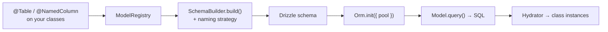

<div align="center">

# 🌊 drizzle-active-record

**Active Record models for [Drizzle ORM](https://orm.drizzle.team).**
Declare a class — get a table, a chainable query builder, relations, soft delete and real class instances back.

[](https://www.npmjs.com/package/@iappx/drizzle-active-record)
[](https://github.com/iappx/drizzle-active-record/actions/workflows/ci.yml)
[](./LICENSE)
[](https://nodejs.org)

```bash
npm install @iappx/drizzle-active-record drizzle-orm pg
```

</div>

---

## Why this exists

Drizzle is a great SQL layer, but it hands you plain rows and a schema you have to keep in sync by hand.
This package keeps Drizzle underneath — and puts your **domain classes on top**.

<table>
<tr><th width="50%">Plain Drizzle</th><th width="50%">With this package</th></tr>
<tr valign="top">
<td>

```ts
const rows = await db
    .select()
    .from(programs)
    .leftJoin(exercises, eq(...))
    .where(and(
        eq(programs.userId, userId),
        isNull(programs.deletedAt),
    ))

// plain objects, joins flattened by hand,
// `deletedAt` remembered by hand
```

</td>
<td>

```ts
const list = await TrainingProgram.query()
    .where({ userId })
    .includeModel(TrainingExercise)
    .endInclude()
    .getAll()

// TrainingProgram[] with methods,
// nested exercises, soft delete applied
```

</td>
</tr>
</table>

## ✨ Highlights

| | |
|---|---|
| 🧩 **Decorators define everything** | One class is the model, the schema and the API surface. No parallel `schema.ts` to maintain. |
| 🔗 **Relations that nest** | `belongsTo` / `hasOne` / `hasMany` / `belongsToMany` — including type-safe nested sub-queries with their own `where`, `orderBy` and `limit`. |
| 🧬 **Real instances, not rows** | Every result is hydrated back into your class — methods, getters and nested relation instances included. |
| ♻️ **Dirty tracking** | `save()` writes only the fields you actually changed; `changed()` tells you which ones. |
| 🗑️ **Soft delete on autopilot** | `paranoid: true` and deleted rows disappear from every `SELECT`, `count()` and `EXISTS` sub-query. |
| 🎯 **Expressive filters** | `Op.gte`, `Op.in`, `Op.like`, `Op.between`, `Op.or(...)` — or drop to a raw Drizzle `SQL` fragment any time. |
| ✍️ **Your naming, your rules** | Pluggable naming strategy: snake_case, PascalCase, preserve — or a five-line class of your own. |
| 🔒 **Transactions everywhere** | Any read or write takes `{ transaction }` and joins an existing Drizzle transaction. |
| 🪶 **Zero runtime deps** | `drizzle-orm` and `pg` are peer dependencies — the library reuses the instance your app already has. |

## 🗺️ How it works



Decorators only *record* metadata. Nothing touches the database until `Orm.init()`, so models can be
imported in any order and the naming strategy can be installed after the model files are loaded.

---

## 🚀 Quick start

### 1. Describe a model

```ts
import {
    BelongsTo, CreatedColumn, DataType, DeletedColumn, ForeignKey,
    HasMany, NamedColumn, QueryableModel, Table, UpdatedColumn,
} from '@iappx/drizzle-active-record'

// attributes accepted by create() / update()
interface TrainingProgramCA {
    id?: number
    title: string
    userId: number
}

@Table('training_program', { paranoid: true })
export class TrainingProgram extends QueryableModel<TrainingProgram, TrainingProgramCA> {
    @NamedColumn(DataType.BIGINT, 'id', { primaryKey: true, autoIncrement: true })
    id: number

    @NamedColumn(DataType.STRING, 'title')
    title: string

    @ForeignKey(() => User)
    @NamedColumn(DataType.BIGINT, 'user_id')
    userId: number

    @CreatedColumn()
    @NamedColumn(DataType.DATE, 'created_at')
    createdAt: Date

    @UpdatedColumn()
    @NamedColumn(DataType.DATE, 'updated_at')
    updatedAt: Date

    @DeletedColumn()
    @NamedColumn(DataType.DATE, 'deleted_at')
    deletedAt: Date

    @BelongsTo(() => User)
    user: User

    @HasMany(() => TrainingExercise)
    exercises: TrainingExercise[]
}
```

### 2. Boot the ORM once

```ts
import { Pool } from 'pg'
import { Orm, SchemaBuilder, SnakeCaseNamingStrategy } from '@iappx/drizzle-active-record'
import './models'  // side-effect import: decorators must run before build

SchemaBuilder.setNamingStrategy(new SnakeCaseNamingStrategy())

Orm.init({ pool: new Pool({ host, port, user, password, database }) })
```

### 3. Use it

```ts
const programs = await TrainingProgram.query()
    .where({ userId, title: Op.like('%warm%') })
    .orderBy('createdAt', 'DESC')
    .limit(20)
    .includeModel(TrainingExercise)
        .where({ isActive: true })
        .orderBy('position')
    .endInclude()
    .getAll()

programs[0].exercises[0] instanceof TrainingExercise  // true

const program = await TrainingProgram.create({ title: 'Push day', userId })
await program.update({ title: 'Push day A' })
await program.destroy()  // soft delete — the row stays, deletedAt is set
```

> [!TIP]
> Everything after this point is reference material — jump to what you need:
> [Models](#-models) · [Column naming](#-column-naming) · [Bootstrap](#-bootstrap) · [Querying](#-querying) ·
> [Filters](#-filter-operators) · [Relations](#-relations--includes) · [Writing](#-writing-data) ·
> [Transactions](#-transactions) · [Soft delete](#-soft-delete) · [Raw SQL](#-raw-sql-escape-hatches) ·
> [TypeScript setup](#-typescript-setup)

---

## 🧩 Models

A model is a class extending `QueryableModel<Self, CreationAttributes>` and decorated with `@Table`.

| Decorator | What it does |
|---|---|
| `@Table(name, { paranoid })` | Registers the class as a table. Object form `@Table({ tableName, paranoid })` works too. |
| `@NamedColumn(type, name?, options?)` | Maps a property to a column. Omit `name` to let the [naming strategy](#-column-naming) derive it. |
| `@CreatedColumn()` / `@UpdatedColumn()` | Marks timestamp columns. Stack above `@NamedColumn`. |
| `@DeletedColumn()` | Soft-delete marker. Active only together with `paranoid: true`. |
| `@ForeignKey(() => Model)` | Marks the FK column. Stack above `@NamedColumn`. |
| `@BelongsTo(() => Model)` | Many-to-one (this table holds the FK). |
| `@HasOne(() => Model)` | One-to-one. |
| `@HasMany(() => Model)` | One-to-many (the other table holds the FK). |
| `@BelongsToMany(() => Model, { through: () => Junction })` | Many-to-many through a junction model. |

**Column options:** `primaryKey`, `autoIncrement`, `allowNull`, `defaultValue`.

**Data types:** `INTEGER`, `BIGINT`, `STRING`, `TEXT`, `DATE`, `BOOLEAN`, `FLOAT`, `JSON`, `JSONB`,
`ENUM('a', 'b', ...)`.

Relation targets are always passed as thunks (`() => User`) so circular imports between models are fine.

## 🔤 Column naming

There is **no implicit convention** — a column name comes either from you or from a naming strategy.
The library never guesses silently.

```ts
@NamedColumn(DataType.STRING, 'first_name')   // explicit — always wins
firstName: string

@NamedColumn(DataType.STRING)                 // derived by the configured strategy
firstName: string
```

Install the convention once, before the schema is built:

```ts
SchemaBuilder.setNamingStrategy(new SnakeCaseNamingStrategy())
```

| Strategy | `firstName` becomes |
|---|---|
| `SnakeCaseNamingStrategy` | `first_name` |
| `PascalCaseNamingStrategy` | `FirstName` |
| `PreserveCaseNamingStrategy` | `firstName` |

Anything else is one method away:

```ts
import { INamingStrategy, StringUtils } from '@iappx/drizzle-active-record'

export class UpperSnakeCaseNamingStrategy implements INamingStrategy {
    public columnName(propertyKey: string): string {
        return StringUtils.toSnakeCase(propertyKey).toUpperCase()
    }
}
```

> [!WARNING]
> If a column has neither an explicit name nor a strategy, `SchemaBuilder.build()` throws and names the
> offending `Model.property`. An unnamed column never reaches the database by accident.

Table names are always explicit: `@Table('training_program')`.

## ⚙️ Bootstrap

```ts
Orm.init({ pool })                      // builds the schema and creates the db instance
Orm.init({ db: drizzle(pool, { schema }) })  // or hand over a ready drizzle instance
```

| Member | Purpose |
|---|---|
| `Orm.init(options)` | Builds the Drizzle schema from the registry and connects. Returns the db instance. |
| `Orm.db` | The underlying Drizzle instance — for raw queries and `db.transaction(...)`. |
| `Orm.isInitialized` | `true` once `init` has run. |
| `Orm.close()` | Ends the pool the ORM created itself. |

`tryGetOne()` / `tryFindByPk()` throw `ModelNotFoundError` when nothing matches. Apps with their own
error hierarchy can swap it out:

```ts
Orm.init({ pool, modelNotFoundErrorFactory: model => new MyNotFoundException(model.name) })
```

## 🔍 Querying

`Model.query()` returns a `DBModelQuery`. Builder methods chain; execution methods finish the chain.

**Builder**

| Method | Description |
|---|---|
| `.where(options)` | AND-merged conditions. Scalar → `=`, array → `IN`, `null` → `IS NULL`, `Op.*` wrapper, or a raw `SQL`. |
| `.orWhere(options)` | ORs this call against everything accumulated so far. |
| `.select(columns)` | `['id', 'title']`, `{ id: true }`, or `{ extras: { ... } }` for computed columns. |
| `.orderBy(column, direction)` | Also accepts `[[column, direction], ...]` or a raw `SQL`. |
| `.limit(n)` / `.offset(n)` | Pagination. |
| `.includeModel(Model, { as? })` | Opens a typed sub-query on a relation — closed with `.endInclude()`. |
| `.include(...)` / `.includeQueryable(...)` | Raw includes; `{ required: true }` becomes `WHERE EXISTS`. |
| `.transaction(tx)` | Runs inside an existing Drizzle transaction. |
| `.column(field)` | The underlying Drizzle column, for hand-written `SQL`. |

**Execution**

| Method | Returns |
|---|---|
| `.getAll()` | `M[]` |
| `.getOne()` | `M \| null` |
| `.tryGetOne()` | `M` — throws `ModelNotFoundError` when missing |
| `.getByPK(id)` | `M \| null` |
| `.tryFindByPk(id)` | `M` — throws when missing |
| `.count()` | `number` |
| `.delete()` | Mass delete — soft on `paranoid` models |
| `.toSQL()` | `{ sql, params }` without executing — great for debugging and tests |

## 🎯 Filter operators

```ts
import { Op } from '@iappx/drizzle-active-record'

await User.query()
    .where({
        age: Op.gte(18),
        id: Op.in([1, 2, 3]),
        name: Op.iLike('%foo%'),
        createdAt: Op.between(from, to),
        deletedAt: Op.isNull(),
        status: Op.or(Op.eq('draft'), Op.eq('review')),  // one column, several options
    })
    .orWhere({ isAdmin: true })                          // across columns
    .getAll()
```

| Group | Operators |
|---|---|
| Comparison | `eq` `ne` `gt` `gte` `lt` `lte` |
| Text | `like` `notLike` `iLike` `notILike` |
| Sets | `in` `notIn` `between` `notBetween` |
| Null | `isNull` `isNotNull` |
| Combinators | `and(...)` `or(...)` — within a single column |

`Op.eq(null)` / `Op.ne(null)` collapse to `IS NULL` / `IS NOT NULL` automatically.
For raw condition arrays there is `SqlConditions.allOf(conditions)` and `SqlConditions.anyOf(conditions)`.

## 🔗 Relations & includes

The typed form nests naturally and reads like the shape of the result:

```ts
const users = await User.query()
    .includeModel(TrainingProgram)
        .where({ isPublic: true })
        .limit(5)
        .includeModel(TrainingExercise)
            .select(['id', 'title'])
        .endInclude()
    .endInclude()
    .getAll()
```

The raw form takes plain objects — handy when includes are built dynamically:

```ts
await User.query()
    .include([
        TrainingProgram,                                        // just the model
        { model: Post, as: 'drafts', where: { status: 'draft' } },
        { model: Team, required: true },                        // WHERE EXISTS — filters the parent
    ])
    .getAll()
```

| Situation | Use |
|---|---|
| Two relations to the same model | `{ as: 'propertyName' }` to disambiguate |
| Filter parents by their children | `{ required: true }` → `WHERE EXISTS (...)` |
| Many-to-many | `@BelongsToMany(() => Tag, { through: () => PostTag })` — the junction is traversed and flattened for you |
| Conditional nesting | `.conditionalEndInclude(flag)` closes the sub-query only when `flag` is true |

## ✍️ Writing data

Reads go through the query builder; writes are Active Record methods on the model.

```ts
// static
const program = await TrainingProgram.create({ title, userId })
await TrainingProgram.bulkCreate([{ ... }, { ... }])
await TrainingProgram.bulkUpsert(rows, {
    conflictKeys: ['externalId'],   // ON CONFLICT (external_id)
    updateKeys: ['title'],          // ... DO UPDATE SET title = excluded.title
    incrementKeys: ['viewsCount'],  // ... views_count = views_count + excluded.views_count
})
await TrainingProgram.destroy({ where: { userId } })
const draft = TrainingProgram.build({ title })   // in-memory only, not saved

// instance
program.title = 'renamed'
program.changed()          // ['title']
await program.save()       // UPDATE ... SET title = $1 — only the dirty column
await program.update({ title: 'renamed again' })
await program.reload({ include: [TrainingExercise] })
await program.destroy()
```

An instance without a primary key value is `INSERT`ed by `save()`; with one, it is `UPDATE`d.

## 🔒 Transactions

Every read and write accepts a Drizzle transaction:

```ts
await Orm.db.transaction(async transaction => {
    const program = await TrainingProgram.create({ title, userId }, { transaction })

    await TrainingExercise.bulkCreate(rows, { transaction })

    const count = await TrainingExercise.query()
        .where({ programId: program.id })
        .transaction(transaction)
        .count()
})
```

## 🗑️ Soft delete

Mark the table `paranoid` and give it a `@DeletedColumn()`:

```ts
@Table('training_program', { paranoid: true })
```

From then on the library keeps the bookkeeping:

- `destroy()` sets `deletedAt` instead of deleting the row;
- every `SELECT` — top-level, nested include and `WHERE EXISTS` sub-query — adds `deleted_at IS NULL`;
- `count()` skips deleted rows;
- `.delete()` on a query becomes a mass soft delete.

> [!NOTE]
> The filter is unconditional: a `paranoid` model never returns deleted rows through the query builder.
> When you genuinely need them — an admin trash bin, a restore feature — go around it via `Orm.db`, or
> clear `deletedAt` with a direct Drizzle `update`.

## 🧪 Raw SQL escape hatches

Nothing is a dead end — `sql` and `SQL` are re-exported from the very same Drizzle instance the
library uses, so hand-written fragments always fit:

```ts
import { sql } from '@iappx/drizzle-active-record'

const query = User.query()

await query
    .where(sql`lower(${query.column('email')}) = ${email.toLowerCase()}`)
    .select({ extras: { postCount: sql<number>`(select count(*) from post where post.user_id = "user".id)`.as('post_count') } })
    .orderBy(sql`${query.column('createdAt')} desc nulls last`)
    .getAll()

query.toSQL()   // { sql, params } — inspect without executing
Orm.db          // the plain Drizzle instance, for anything the builder doesn't cover
```

## 🧱 Dialects

The schema layer talks to the database through `ISchemaDialect`; PostgreSQL (`PgSchemaDialect`) ships
built in. Swap it before the schema is built:

```ts
SchemaBuilder.setDialect(new MySchemaDialect())
```

Everything else — relations, query building, hydration — is dialect-agnostic.

## 🔧 TypeScript setup

Decorators need two `tsconfig.json` flags, and one flag must stay off:

```jsonc
{
  "compilerOptions": {
    "experimentalDecorators": true,
    "useDefineForClassFields": false,   // must be false: the ORM installs property accessors
    "strictPropertyInitialization": false
  }
}
```

> [!NOTE]
> `useDefineForClassFields` defaults to `true` for `target: ES2022` and above. Left on, class fields
> shadow the accessors the ORM installs and every property reads back as `undefined`.
> Keeping `strictPropertyInitialization` on is fine too — just declare columns as `id!: number`.

**Requirements:** Node 18+, `drizzle-orm` ≥ 0.45, `pg` ≥ 8.7, PostgreSQL.

## 📦 Scripts

```bash
npm run build          # compile to ./lib
npm test               # jest
npm run test:coverage  # jest with coverage
```

## 📄 License

[MIT](./LICENSE) © iappx
